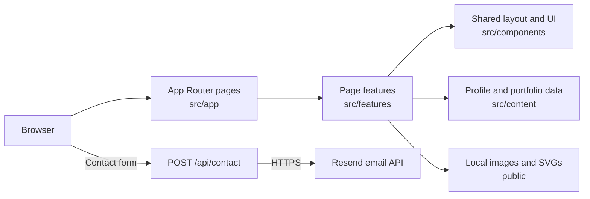

# Portfolio

A personal portfolio for Reynald Quijano, built to present projects, experience, technical skills, services, and contact options. The interface follows the [original Figma design](https://www.figma.com/design/htPgB4X3o9UtycpH6bcYss/Portfolio-1.0?node-id=0-1) and adapts its editorial layout to smaller screens.

**Live site:** [portfolio-icyzamas-projects.vercel.app](https://portfolio-icyzamas-projects.vercel.app)

## What the application includes

| Route | Purpose |
| --- | --- |
| `/` | Introduction and entry points to the rest of the site |
| `/about` | Biography and grouped technical skills |
| `/projects` | Filterable project cards and a details dialog with source or live links |
| `/experiences` | Organizations, hackathons, and internship tabs; the selected tab is reflected in the URL |
| `/services` | Web development services |
| `/blog` | Upcoming writing topics and a topic suggestion that opens an email draft |
| `/contact` | Contact links and a form for opportunities, projects, and collaboration |
| `POST /api/contact` | Validates form submissions and sends email through Resend |

## Architecture

The project uses the **Next.js App Router**. Files in `src/app/` define routes and metadata; each page delegates its UI to a matching module in `src/features/`. The root layout supplies the shared header, footer, fonts, preloader, motion behavior, and skip link.



Most content is stored in TypeScript modules rather than fetched from a CMS. `src/content/profile.ts` holds the name, bio, contact links, and resume path. `src/content/portfolio.ts` holds projects, organizations, services, and planned blog topics. `src/content/navigation.ts` defines the main navigation. Project and organization images are local assets under `public/`.

Interactive elements are client components where browser state is needed: project filters and dialogs, experience tabs, skill popovers, image previews, motion, and the contact form. Route files, the shared layout, and other page composition stay in the App Router's server-rendered structure.

### Contact flow

1. The Contact page posts JSON to `/api/contact`.
2. The Node.js route checks the request origin, content type, payload size, field values, and a per-instance rate limit.
3. The route sends the portfolio owner an email through the Resend HTTPS API. If that succeeds, it attempts a separate confirmation email to the visitor.
4. Responses and outbound email requests use `no-store`. A failed confirmation does not turn an accepted owner notification into a failed form submission.

The contact endpoint needs server-side configuration and cannot run as a static HTML export. See [Contact email setup](docs/contact-email.md) for verified-domain setup, proxy trust, rate-limit behavior, and delivery checks.

### Caching

Next.js manages page and content-hashed build assets. Local files under `public/figma`, `public/skills`, `public/projects`, and `public/experiences` use revalidation headers from `next.config.ts`. Content changes are published by rebuilding and deploying the site. The contact endpoint is uncached. See [Caching policy](docs/caching.md) for the resource-by-resource rules and verification steps.

## Tech stack

| Area | Technology |
| --- | --- |
| Framework | Next.js 16 App Router, React 19 |
| Language | TypeScript |
| Styling | Tailwind CSS 4, global CSS, and CSS Modules |
| Images and fonts | `next/image`; Archivo Black and DM Sans through `next/font` |
| Email | Node.js route handler and Resend HTTPS API |
| Quality checks | ESLint, Node.js test runner, and repository QA scripts |
| Package manager | npm (`package-lock.json`) |

## Project structure

```text
src/
  app/                 Routes, metadata, root layout, global styles, contact API
  components/
    layout/             Shared header and footer
    ui/                 Reusable visual and interaction components
  content/              Profile, navigation, projects, organizations, services
  features/             UI and behavior grouped by page
public/                 Local images, icons, and Figma exports
scripts/                QA and audit scripts
docs/                   Contact, caching, and QA notes
```

## Run locally

Install Node.js and npm, then from the repository root:

```bash
npm ci
npm run dev
```

Open [http://localhost:3000](http://localhost:3000). The pages work without email credentials; sending the contact form requires the variables below.

For a production build:

```bash
npm run build
npm run start
```

### Contact environment variables

Copy `.env.example` to `.env.local` and set the server-only values needed for email delivery:

| Variable | Purpose |
| --- | --- |
| `RESEND_API_KEY` | Resend API key with sending access |
| `CONTACT_FROM_EMAIL` | Sender address on a verified domain |
| `CONTACT_TO_EMAIL` | Destination inbox; defaults to the email in `profile.ts` if omitted |
| `CONTACT_TRUSTED_IP_HEADER` | Optional header set by a trusted reverse proxy for per-client rate limiting; Vercel is detected automatically |

Do not prefix these variables with `NEXT_PUBLIC_` or commit `.env.local`. The deployment must support the Node.js runtime and outbound HTTPS for the contact form.

## Checks

| Command | What it checks |
| --- | --- |
| `npm run lint` | ESLint |
| `npm run build` | Production compilation |
| `npm run qa:contact` | Contact route behavior with mocked email delivery |
| `npm run qa:contact-ui` | Contact form interaction tests |
| `npm run qa:images` | Image lifecycle and keyboard interaction tests in a simulated DOM |
| `npm run qa` | HTTP responses, rendered content, local assets, and Contact behavior against a running production server |
| `npm run qa:cache` | Cache headers and revalidation against a running production server |

For the last two commands, run `npm run build` and start the production server in another terminal first. Set `QA_BASE_URL` if it is not running at `http://127.0.0.1:3000`. The mocked checks do not send real email. See the [QA notes](docs/qa/enhancements-2026-10-23.md) for recorded results and remaining visual checks.

## Updating the site

Edit `src/content/profile.ts` for the bio, contact links, site URL, and resume path. Edit `src/content/portfolio.ts` for projects, organizations, services, and upcoming posts. Add corresponding images to `public/` and update their imports when changing visual content. The resume download is disabled until a file is added under `public/` and `profile.resume` points to it.
